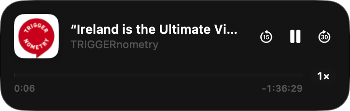
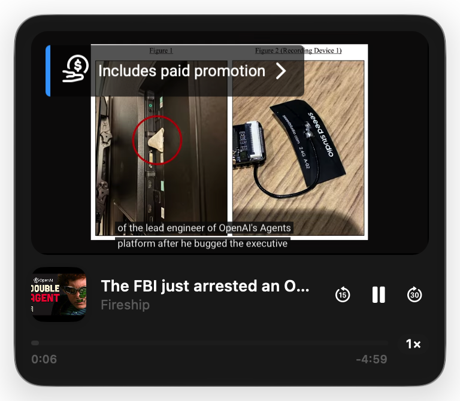

# Alfred RSS Player


A small native mini player for macOS that plays podcasts and YouTube videos from [Alfred RSS](https://github.com/haydn-rfp/alfred-rss), or from anything that can open a link.

It lives in the menu bar. Click the icon and a compact Liquid Glass player drops down under it and stays there while you work.





## Features

* **Podcasts and audio files:** streamed directly with macOS's own player.
* **YouTube:** plays in a 16:9 panel above the controls using YouTube's official embedded player. Hide the video or the window and the sound keeps going.
* **One window:** click the menu-bar icon to show or hide it. It opens attached under the icon and floats above other windows.
* **Controls:** −15s, play/pause, +30s, a scrubber, and playback speed from 0.8× to 2×.
* **Picks up where you left off** in every episode.
* **Now Playing:** shows in Control Centre, and works with your keyboard's media keys and AirPods controls.
* **No Dock icon, no account, no server.**

Right-click the menu-bar icon for Pause/Play, Stop, Attach to Menu Bar and Quit.

## Requirements

* macOS 26 Tahoe or later, on Apple silicon.
* Apple's Command Line Tools, to build it: `xcode-select --install`. Xcode itself isn't needed.

## Installation

The app isn't signed with an Apple Developer ID, so it's installed by building it on your Mac:

```sh
git clone https://github.com/haydn-rfp/alfred-rss-player.git
cd alfred-rss-player
./build.sh
```

This builds the app and installs it to `~/Applications/Alfred RSS Player.app`. Run `./build.sh` again after pulling updates.

To keep the menu-bar icon after restarts, add **Alfred RSS Player** in **System Settings → General → Login Items**. Otherwise it launches itself the first time something is sent to it.

## Playing things from other apps

Everything is controlled with `alfredplayer://` links, so any app, script or Alfred workflow can use it:

| Link | Does |
| --- | --- |
| `alfredplayer://play?url=…&title=…&artist=…&artwork=…&id=…` | Play an audio file or YouTube link. Everything after `url` is optional. `artwork` is a URL or a file path, and `id` is used to remember the position. Values must be URL-encoded. |
| `alfredplayer://toggle` · `pause` · `resume` · `stop` | Playback |
| `alfredplayer://skip?by=30` | Skip forward, or back with a negative number |
| `alfredplayer://speed?rate=1.5` | Playback speed |
| `alfredplayer://show` · `hide` · `window` | Show, hide or toggle the player |

For example, from Terminal:

```sh
open "alfredplayer://play?url=https%3A%2F%2Fwww.youtube.com%2Fwatch%3Fv%3DdQw4w9WgXcQ&title=Example"
```

The player writes what's playing to `~/Library/Application Support/Alfred RSS Player/state.json`, so other tools can show it.

## Limitations

* Videos whose owners have disabled embedding won't play; open those in the browser instead.
* Pages that need a login to watch, and Spotify-only episodes (copy-protected), can't be played.
* Known issue: dragging the window by its background doesn't work yet.

## Licence

[MIT](LICENSE)
